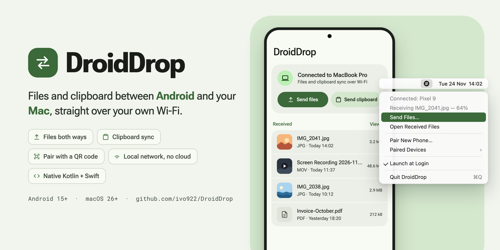

# DroidDrop

Android ↔ macOS file transfer and clipboard sync over the local network.

- Wire protocol: [`protocol/SPEC.md`](protocol/SPEC.md), conformance fixtures in [`protocol/fixtures/`](protocol/fixtures/)
- Design spec and milestone plans live in `docs/`, which is local only (git-ignored) and not part of the repo.

## Install

Download the Android `.apk` and the Mac `-macOS.zip` from the [latest release](../../releases/latest). Steps for each
are in the release notes; the Mac app is not notarized, so its first launch needs **Open Anyway** in System Settings ›
Privacy & Security.

## Verify

`scripts/check.sh` runs every gate: Swift tests, Android unit tests, lint, builds and the Swift ↔ Kotlin interop.

## Release

Push a `vX.Y.Z` tag. [`release.yml`](.github/workflows/release.yml) runs `scripts/check.sh`, builds both apps with
`scripts/build-release.sh` and publishes them as a GitHub Release. The tag sets the version (`scripts/release-version.sh`).
The APK is signed with the release key from the `DROIDDROP_KEYSTORE_BASE64` and `DROIDDROP_KEYSTORE_PASSWORD` secrets;
to build one locally, set `DROIDDROP_KEYSTORE` (path) and `DROIDDROP_KEYSTORE_PASSWORD`.

## Layout

| Path | What |
|---|---|
| `protocol/` | Normative spec, fixtures, fixture generator |
| `macos/DroidDropKit/` | Swift package with all Mac-side logic (`swift test`) |
| `macos/DroidDrop/` | Menu-bar app shell (XcodeGen: `cd macos && xcodegen generate`) |
| `android/core/` | Pure Kotlin/JVM protocol logic (`./gradlew :core:test`) |
| `android/app/` | Android app |
| `android/devcli/` | JVM CLI client for exercising the Mac without a phone |
| `docs/` | Local only, git-ignored: design spec and milestone plans |
